## Editing players and teams
This is a short guide to create or edit players and teams with the built-in editors, add your own images (skin layers, heads, kits...) and send your work so it can be added to the mod.

Everything starts from **Tools** in the main menu. The editors work on the data pack (`data/` when you run from source, `mod_data/` in the installed version). What you change is not written in the data pack, it is kept apart in `user_data/edits/` (records, written by the program) and `user_data/mod_data/` (your files), so a new release never erases your work.

*Tools menu:*  
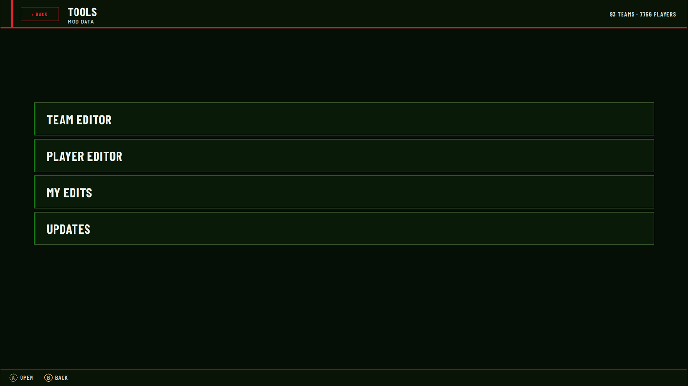

Some keys that work in both editors: `Ctrl+S` save, `Ctrl+Z` undo, `Ctrl+Y` redo, `Ctrl+F` filter, `Ctrl+N` new, `Ctrl+D` duplicate. The bar at the bottom always shows what the gamepad/keyboard can do on the selected field.

## Players

### Find or create a player
The list on the left can be filtered by name, id, position or team (`FILTERS` for more). `+ NEW PLAYER` asks for:
- In-game name (14 characters max, it is what the game shows)
- First season and primary position (it goes in the players file of the player being edited, or the biggest one)

`DUPLICATE` copies the selected player, which is the fastest way to start from a similar one. Your new players get an id far above the ones of the data pack (10,000,000 and more, a different block per install), so two persons creating players never clash.

*New player:*  
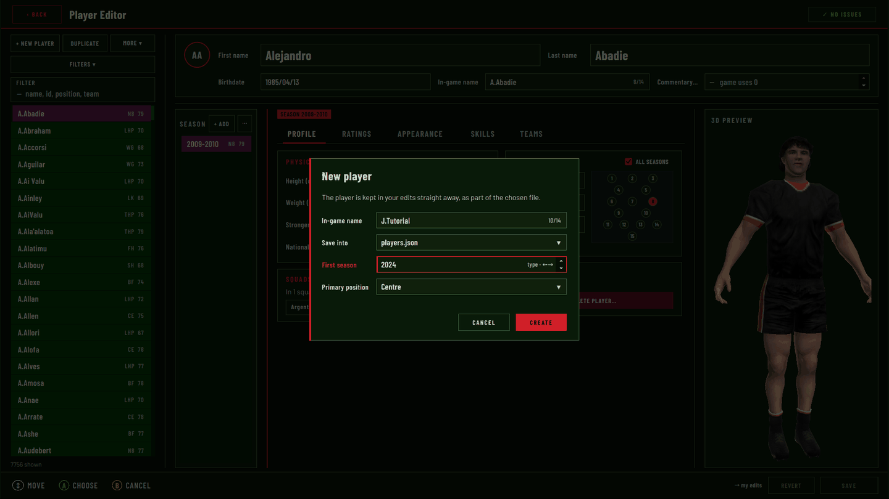

At the top you find the identity, the same for all seasons: first name, last name, birthdate (`YYYY/MM/DD`), in-game name and commentary name — the surname the commentators say, picked from the clips recorded in the game (the list opens on the closest match to the last name; ▶ plays the clip, and resting on a name in the list plays it too).

### Seasons
A player has one set of ratings and looks **per season** (the same man is not rated the same in 2009 and 2024). Seasons are shown as the two years they cover (`2023-2024`) and added by the year they end in. The `SEASON` column lists them, `+ ADD` creates a new one (copied from another season) and `⋯` has the other actions.

Every card has an `ALL SEASONS` box. Ticked, what you change is applied to all the seasons of the player. Unticked, only to the selected one. Check it before you edit, it is the most common surprise.

### Profile
*Height, weight (greyed when empty: the 180 cm / 70 kg the game then uses), stronger foot, nationality, up to 3 positions (the pitch shows which shirts the player fits).* The `Teams` tab lists the squads where he is named, season by season (click one to jump to the team).  
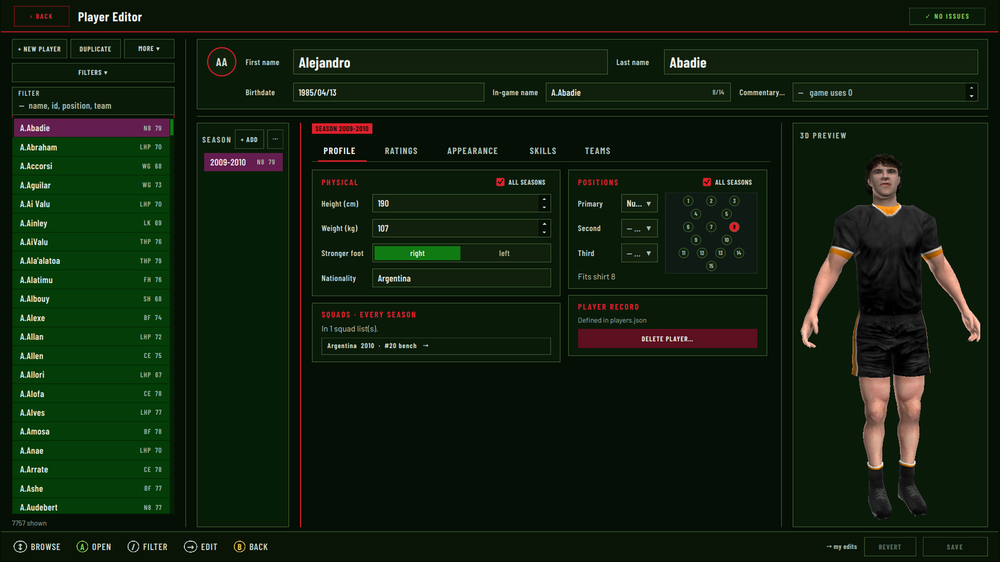

If a player doesn't fit his shirt in a team, the team editor will flag it, so choose the positions with care.

### Ratings
24 ratings in 6 groups, `OVR` is computed for the primary position. Type the number, `←→` is ±1, `⇧←→` is ±5, `Y` takes the value of the previous season. `COPY RATINGS FROM…` copies a whole season into another one.

*Ratings:*  
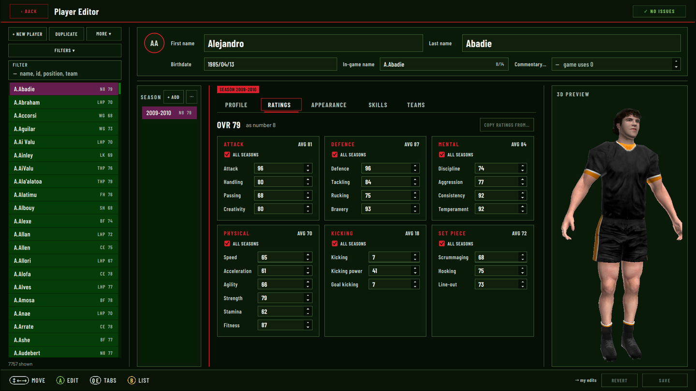

### Skills
*Extra ratings (crash ball, gap defence), AI tendency, star player ability and the 13 special skills:*  
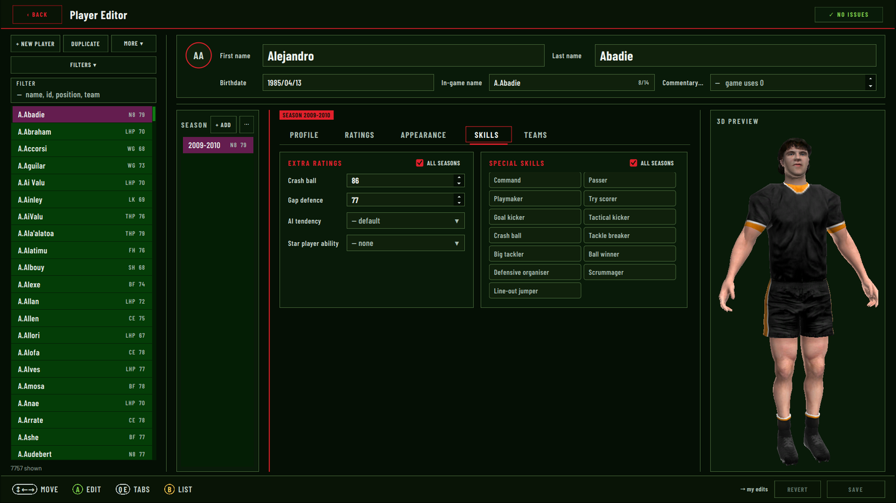

The star ability gives the player the special moves of its class (kicks, tackle breaks, ruck...) whatever his ratings are.

### Appearance
This is where the images go.

*Appearance (custom head, boots, skin and strap layers):*  
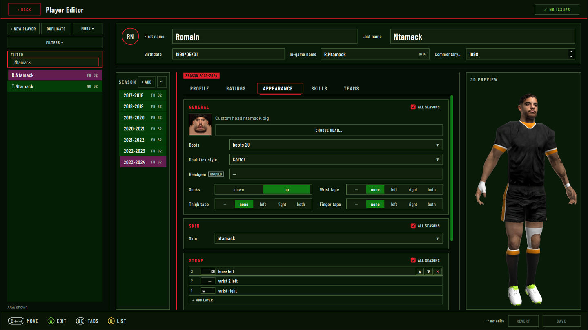

- **Head**: `CHOOSE HEAD…` opens the head browser. `stock` are the ~550 faces of the original game, `custom` are the `.big` files of `data/players/heads/`. Click one to try it on the 3D preview, then `USE THIS HEAD`.
- **Boots**: the list has sections. `Stock` is the game's 10 styles, then the brands listed in `players/boots/boots.json` (`{"Nike": ["players/boots/boots_6.png", ...]}`, a title and the boots it holds; edit it to sort the boots your own way), and `Custom` for the images that file does not place: the boots you add. Sections fold: only the one holding the current boots is open.
- **Goal-kick style**: the kicking animation of the player, any of the 20 stock ones.
- **Socks and tapes**: wrist, thigh, finger (`none` unless you pick one).
- **Skin**: the list has a `Default` section (the 4 stock tones) and a `Custom` one (your textures).
- **Layers**: strap, bottom baselayer, top baselayer, gloves. They are painted over the skin in this order, and each one can have several layers (`▲▼` to reorder, `✕` to remove).

*Head browser:*  
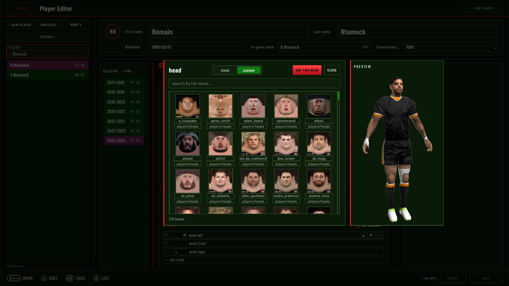

### Add your own assets
Every asset picker (skin, layers, boots, head, kits, logos, ball, banners, pads) has `Load from disk…` (the boots list: `Load from file…`, one image) and, for the series, `Load folder from disk…`: pick a file or a folder anywhere, it is copied into `user_data/mod_data/` at the right place and selected. Copying by hand into `user_data/mod_data/` works too (restart after):

| What | Folder | Image |
|---|---|---|
| Skin | `players/skins/` | PNG 512×256, no transparency |
| Strap layer | `players/straps/` | PNG 512×256 with transparency |
| Baselayer | `players/baselayers/` | PNG 512×256 with transparency, name it `baselayer_top_<colour>.png` or `baselayer_bottom_<colour>.png` |
| Gloves | `players/gloves/` | PNG 512×256 with transparency |
| Boots | `players/boots/` | PNG 256×256 |
| Head | `players/heads/` | `.big` file |

All the skin images share the same layout as the game skin (512×256), the easiest way is to start from an existing file of the same folder and paint over it. Layers must have transparency, otherwise they hide the whole skin: the editor tells you with a `NO ALPHA` tag. An image of another size is resized, with a `RESIZED` tag. A `MISSING` tag means the file is not found.

Then in `Appearance`, `ADD LAYER` (or the skin / boots list) shows your new files, or use `Browse file…`.

*Add a layer:*  
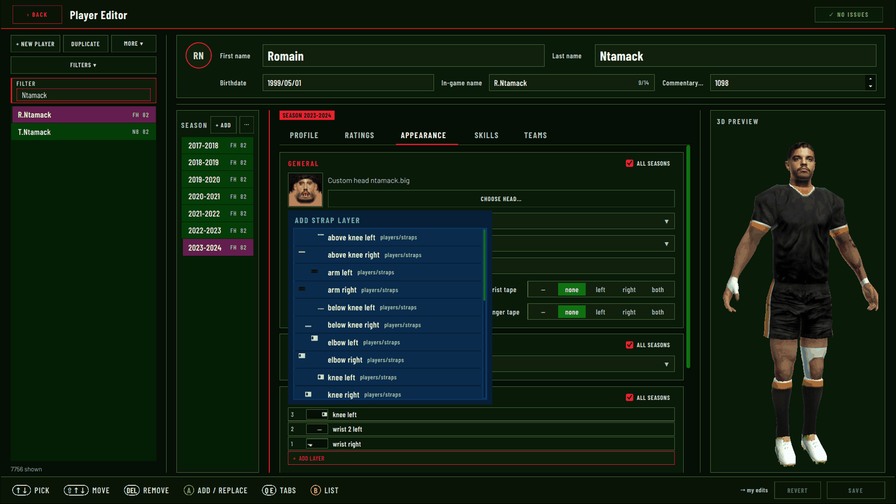

Heads are not made in the editor, they are `.big` files made with the community tools (see the heads credits in `src/CREDITS.MD`). `LOAD FILE…` / `LOAD FOLDER…` in the head browser adds them to its `custom` tab.

### Save
`SAVE` (bottom right, `→ my edits`) keeps the player in your edits. `REVERT` goes back to the last save. The list on the left shows an issue count for broken players, the badge at the top right tells if the selected one is fine.

### Change many players at once
`SELECT` (above the list) puts a tick box on every player. Click to tick, `Shift`+click to tick a run, `ALL` ticks every player the list shows: filter by team or type a position first to pick a whole squad or every prop. `Ctrl`+click on a player starts picking too.

The tabs give way to one form where every field says `keep`. Only what you change is applied:
- **Ratings**: `Level` (club 70, international 80, world class 88) moves all ratings together until the player's overall is that level, so he keeps his strengths. `All ratings` and each group go up or down by the number set.
- **Profile** and **Gear**: one value for all of them (nationality, foot, boots, socks, tapes…).
- **Seasons**: add a season (a copy of each player's newest one) or delete one (a player never loses his last season).
- `Seasons` at the top picks which seasons the changes go to: all, each player's latest, or one year.

The list on the right shows each player's overall now → after. `APPLY TO N` saves them all; `UNDO` then puts them back as they were. `DELETE N PLAYERS…` removes them and takes them out of their squads. `DONE` goes back to editing one player.

## Teams
`Tools > Team editor`. Same logic as the players: list on the left, then the seasons of the team, then the tabs.

### Create a team
`+ NEW TEAM` asks a name, type (club, international or special), group (France, England, International...) and first season. It creates a folder in `teams/` with one blank season. All the images of the team live in this folder (`teams/France/kits_2024/...`), and the editor only browses inside it, so copy your files there first, like for the players.

*New team:*  
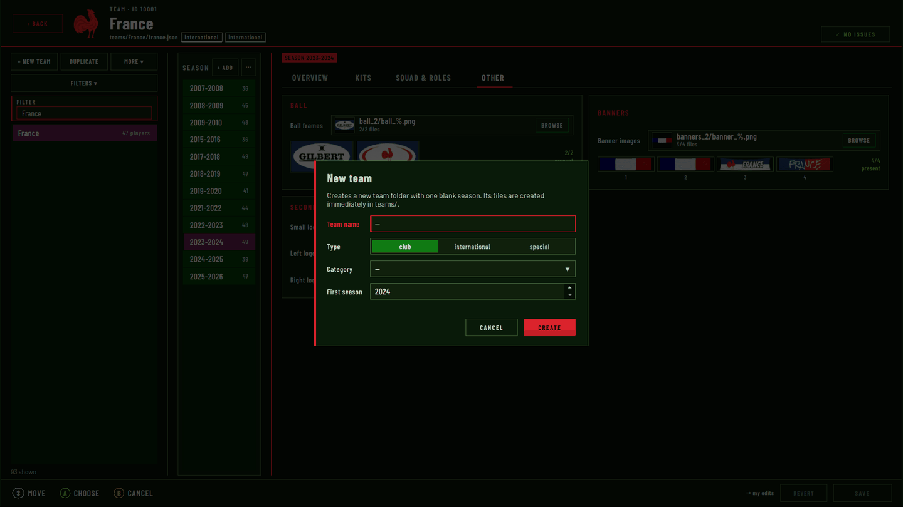

A team has one block per season (name, kits, squad, roles...). `+ ADD`, `DUPLICATE` and `DELETE` in the seasons column work on a season. Duplicating the previous season is usually the quickest way to start a new one. Seasons read `2023-2024`; give the year it ends in when you add one.

### Overview
Name, type, country, group and the two logos: the main crest (256×256, shown in game) and the frontend logo (menus only, the main crest is used if blank). A `×` on a field empties it. `BROWSE` lists the files of the team folder, and `Load from disk…` copies a file next to the current one, or into `kits_<season>`, `logos_<season>`, `ball_<season>`, `banners_<season>` when the field is still empty (a kit variant: `kits_<season>_<variant>`); only a numbered series (ball, banners, back numbers) can load a whole folder. The summary on the right tells at a glance if something is wrong: squad size, starting XV in position, roles set, kits, missing files.

*Overview:*  
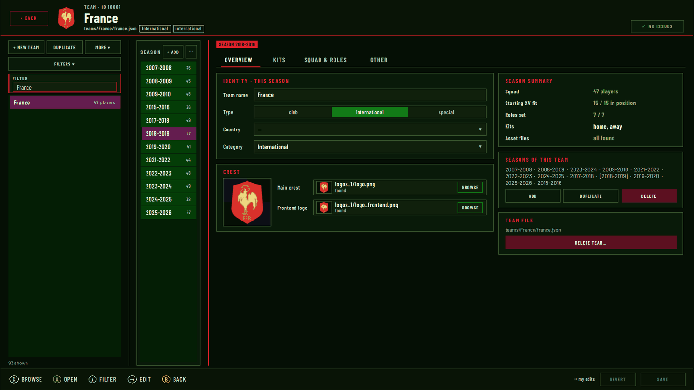

### Kits
The list on the left is the kits in game order: home, away, and as many as you want (third kit etc). You can add, duplicate, rename, delete and reorder them. Each kit has 3 files:
- **Shirt front**: 1024×1024 PNG, the shirt texture
- **Back numbers**: a series of 22 images, `home_back_1.png` to `home_back_22.png`, picked with a `%` pattern (`kits_2024/home_back/home_back_%.png`). The editor shows which numbers are present.
- **Menu picture**: the preview of the kit in the match setup

`Fit` and `Collar` only change the 3D preview of the shirt, `auto` is fine most of the time. `VARIANT` makes a copy of the kit with a few files of its own (a patch, a sponsor...).

*Kits with the 3D preview:*  
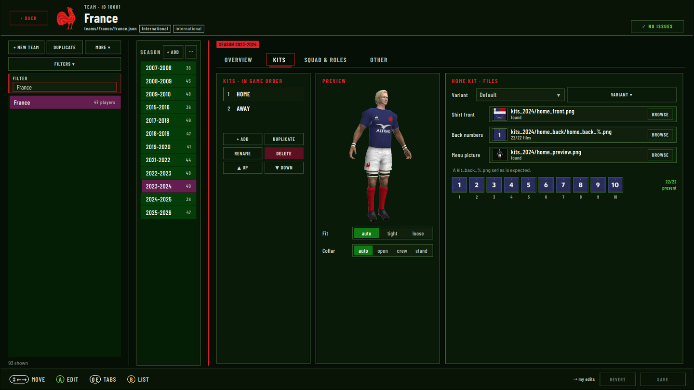

### Squad & roles
The starting XV (shirts 1-15), the 7 replacements (16-22) and the extra players, which are a pool of players beyond the 22. Click a player to pick another one (the list suggests the ones who fit the position), `X` moves him, drag and drop swaps two. This is where you put your new players in a team. An empty squad can be filled in any order: click the shirt you want (the list opens on the position, starting with the players of the team's other seasons) and the others stay empty until you fill them. On the right: captain, vice-captain, goal kicks, punts, kick-offs, and the set plays (greyed when empty: the game then uses player 10, and the default set plays).

**A team can be saved with errors** (a squad under 22 or with empty shirts, a player the files lack, no kit…). A season with errors is marked `DRAFT` and the mod does not use it, nor offer it anywhere (quick match, tournaments…), until it has no error and is saved again. The editor still lists it.

*Squad and roles:*  
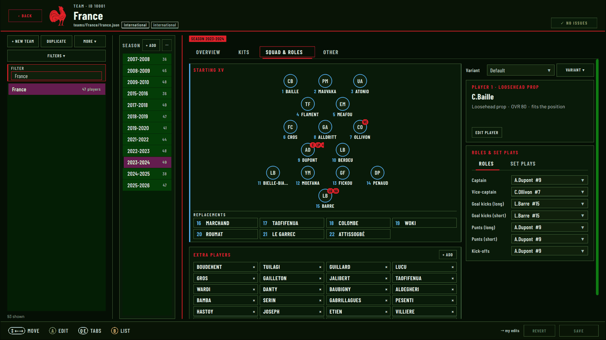

### Other
Ball (2 images, 256×128), banners (4 images, 512×128) and the 3 small logos (128×64) used on the pitch. Same thing: files in the team folder, then `BROWSE`.

*Other:*  
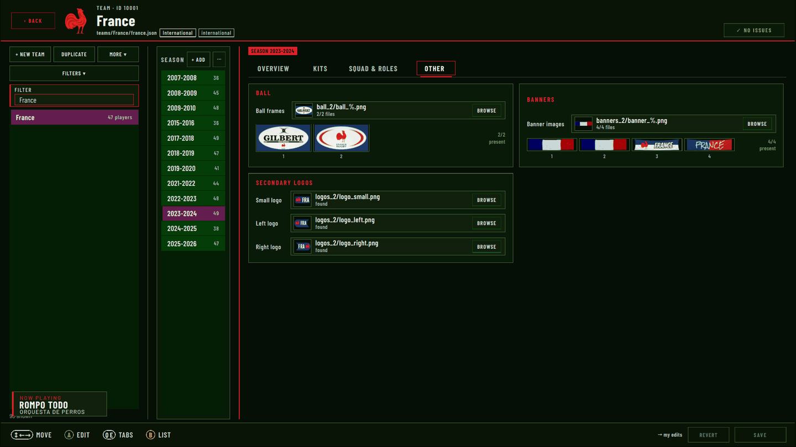

## Tournaments

`Tools > Tournament editor` (or `CREATE YOUR OWN` in Tournament) builds a competition of your own; `New tournament` then lists it like the others, and `PLAY` in the editor opens it there. Each one is a file in `user_data/custom_tournaments/`.

The list also has the game's own competitions (Six Nations 2024, Top 14...): open one to change its name, rules, look or teams (`⇄` swaps a team, it takes the other's games; a team the data lacks can be swapped in). Its format and calendar stay the real ones. `RESET` gives the original back. These edits are kept in `user_data/custom_tournaments/edits/`.

`+ NEW` offers ready-made shapes (a Six Nations, a World Cup, a club league, a European cup, a knockout cup) already filled with the best teams of the data, or a blank one. Five tabs, and the right side always shows the shape, the numbers and what stops it being played:

- `SETUP`: name, season (the squads that play), and the format: a league (optional play-offs, or every club of a data category, one edition per season), pools then knockouts, or a straight knockout cup, with how the knockouts go (who goes through, pairing, bronze final, a drawn game)
- `TEAMS`: `+ ADD TEAMS` ticks several at once (type a name or a category, `ALL` ticks what the search shows). `AUTO-FILL…` takes the best or random teams of a source, `SHUFFLE` deals them again, `⇄` moves a team to another pool, `▲ ▼` order a cup's draw (seed 1 first), `✎` renames a pool
- `RULES`: table points (presets or your own), tie-breakers in order, discipline, half length and injuries / fatigue / suspensions
- `SCHEDULE`: home grounds or neutral stadiums, the final's stadium, when the first round is and the days between rounds
- `LOOK`: description, the game's presentation, the look of a competition (ball, logos, pitch logo, boards), competition squads and kits, the trophy lift

A running tournament has a `Rules` tab listing what it is played under: the laws (50/22, 22m, 80' penalty touch: the edition's, or the wizard's), points and bonuses, how a drawn knockout is decided, bans and the tie-breakers (how teams on the same points are split), with a line on what each law means.

## Send your work to be added to the mod
When you are happy with your edits, open `Tools > My edits`. It lists everything you changed (`NEW` for what you created, `EDITED`, `DELETED`, and `CONFLICT` if a new release changed the same thing as you).

*My edits:*  
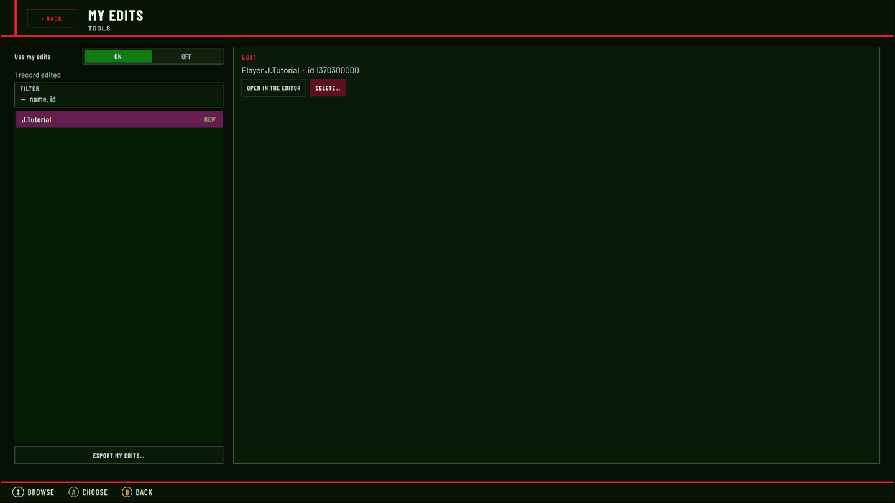

Click `EXPORT MY EDITS…`, pick a folder (`user_data/exported_edits/` is proposed) and the editor creates a folder `my_edits_<date>` (and the same as a `.zip`) with:
- `manifest.json`
- `edits/players/<id>.json` and `edits/teams/<id>.json`: one small file per record
- `files/...`: only your own files the edits use (loaded from disk, not the pack's), with the same paths as in the data pack

Send the zip to me (GitHub issue or the forum thread). I import it with the same tool, merge it into the data pack and it can go in a next release.

Please check before you export:
- No `MISSING` or `NO ALPHA` tag, and `NO ISSUES` at the top right of the editors
- Only export what you want to share, `My edits` lets you drop a record you don't want (`DELETE…`)
- You own the rights of the images, or they come from a patch with a credit I can add in `CREDITS.MD`

## Adding your own heads, skins, kits… (`user_data/mod_data/`)

To add files or replace the pack's, use only `user_data/mod_data/`. It has the layout of the data pack (`players/heads`, `players/skins`, `players/baselayers`, `teams/<Team>/kits_<season>`…), and the installer creates the folders for you with a `README.txt`:

- a file with the same path as one of the pack **replaces** it;
- a file the pack does not have is **added** (a new head, a new team folder with its json, kits and logos…).

The pack is never modified, so a new release never erases them. Restart the program after changing files.

## Commentary names (`user_data/mod_data/commentary/`)

The commentator can say names the game never recorded. Give him a recording of just the name, as a `.wav` file (any quality; it is cut, levelled and converted to the game's format when a match starts):

- **For one player:** Player editor, `Commentary` > `Load from disk…`. The recording is saved as `<id>_<last name>.wav` and the player gets it.
- **For every player with that surname:** put `Dupont.wav` in `user_data/mod_data/commentary/`. Every Dupont who has no clip of his own name uses it.

Players whose clip is only a sound-alike also switch to a clip of their exact surname when one exists. To make names in the stock commentator's voice, see `tools/voicegen`.

## Custom stadiums

A custom stadium takes the place of a stock one in the game (its slot). Put a folder in `user_data/mod_data/stadiums/` with a json named after the folder (lower case, spaces as `_`) and the stadium's scene packs (`.big`, one per environment):

```
stadiums/Eden Park/eden_park.json
stadiums/Eden Park/eden_park.day.big
stadiums/Eden Park/eden_park.night.big
```
```json
{"eden_park": {"name": "Eden Park", "country": "New Zealand", "game_id": 49,
               "scenes": {"day": "eden_park.day.big", "night": "eden_park.night.big"}}}
```

- `game_id`: the stock stadium it overwrites (the ids of `stadiums/stadiums.json`, Auckland = 49).
- `scenes`: environment (`day`, `night`, `overcast`, `cold`) -> scene pack. The stadium is offered in these environments only.
- `roof` (optional): the environment whose scene is under a closed roof (La Defense Arena and Stade Pierre-Mauroy: `"night"`). It is named `closed` in the menus, and a match in it has no rain, snow or wind.
- `files` (optional): any other game file of that stadium, game path -> file, e.g. `{"frontend/textures/stadiums/auckland.d.fsh": "preview.fsh"}`.
- `dressing` (optional): the stadium's own pads, posts and ads (see Stadium dressing below).
- `screen` (optional): the texture of the scene pack's `Textures.fsh` that is a giant screen (La Defense Arena: `"scre"`). Each match paints it with both crests, the team names and the competition logo (or VS). It is set when the match loads: no live score.
- The key (`eden_park`) adds a stadium to the lists; the key of a stock stadium (`"49"`) replaces it everywhere instead (tournament fixtures at that ground included).

The files are put over the slot's only for a match at that stadium, and the name replaces the slot's in the game (not for club grounds whose name is also their team's: Leinster, Ulster, Bourgoin, Castres, Clermont, Paris, Perpignan, Llanelli, Cardiff).

## Stadium dressing

What surrounds the pitch is three independent sets, picked in quick match (advanced settings, `STADIUM`), where the open list previews them (pads and posts on a 3D goal, ads as a strip):

- **pads**: post pads and corner flags, one picture of 1088 × 768 (any 17:12 size works), packed with no empty space, each part in the proportions of the game's texture: the pad wrap at x 0–192 (one face of the post pad, its top at the top), the corner flag pole at x 192–576, the corner flag at x 576–1088 on y 0–256, the pad top below it (y 256–768)
- **posts**: one picture of 128 × 1024 (any 1:8 size works), two strips: the post at x 0–64, from its top down to the top of the pad (it wraps round the post: a stripe climbing across it makes a spiral), and the crossbar turned upright at x 64–128, from the post at the top down to the middle (y 0–837), then its middle part (y 837–1024); the bar's top runs down the right edge. The game has one texture for both posts and one for the crossbar, so both posts wear the strip and the bar's other half mirrors it. The list names plain posts after their colours ("White & red") and painted ones after their file (`tools/make_posts.py` makes the library's: spirals, hoops, tricolour)
- **ads**: the ad boards, a `.fsh` (World Cup or Standard layout), a picture or a folder of pictures (each picture one ad, about 3:1 works best), or a folder with a `.fsh` and pictures named after its boards (`ads0.png`…) that replace those boards

Open any set in `data/stadium_graphics/` as a starting point. Pictures are resized to powers of two (512 max). The older set folders (`pad_wrap.png`, `pad_top.png`, `flag.png`, `flag_pole.png` / `post.png`, `crossbar.png`) still work, a missing picture there keeping the stock one.

Where sets live:

- `stadium_graphics/pads/<set>.png`, `stadium_graphics/posts/<set>.png`, `stadium_graphics/ads/<set>/`: sets for any match (`Load from disk…` in the ads list copies yours there)
- `competitions/<competition>/assets/pads.png`, `.../posts.png`, `.../ads` (or `<season>/pads.png`… when seasons differ): a competition's, named in its json (`"pads"`, `"posts"`, `"adboards"`, at the root or per season; seasons can share a set)
- the game itself: every stock stadium's own sets, listed as `Stock · …`

`Tools > Stadium editor` shows the mod's own stadiums (the folders of `stadiums/` with scene packs) in 3D (drag to turn, right drag to slide, wheel or `+ −` to zoom, five camera views, day / overcast / night / cold when the stadium has them). The view draws what the game does: the baked lighting and shadows, the sky, the roof glass, the line markings and the pitch detail (team flags and banners as plain stand-ins). Hovering a set in the pads, posts or ads list puts it on the stadium; `A competition's look` tries a competition's three at once. `SAVE` keeps the picks as the stadium's `"dressing"` in `user_data/edits/stadiums/<stadium>.json` (like every edit: the stadium's own file in the data pack is never written, and a new release does not erase them), `RESET` goes back to the stock sets of its slot and any pitch. The `Pitch` tab ticks the `environments` a match there may use (day, overcast, night, cold; saved as `"environments"`, at least one stays; unticked ones are not offered in quick match and not drawn by tournament weather). It also sets the mowing `stripes` (opacity and grass brightness, for the environment shown under the 3D view; `STOCK` goes back to the scene pack's own) and lays the game's pitch textures on the grass (hover or arrow over a tile), ticking the ones a match at that stadium may use: saved as `"pitches"` (names such as `"Reg2_08_muddy_n"`; none ticked = any). The mod adds three pitches of its own, `Mod_08_synthetic_d`, `Mod_08_synthetic_n` (artificial turf: an even bright green with a fine fibre weave) and `Mod_08_hybrid_d` (natural grass stitched with fibres): packs in `data/pitches/` built from the game's "best" pitches by `tools/make_pitches.py`. The game only takes its own pitch names, so a match on one rewrites the first line of the scene's `Config2.bin` and puts the pack at the game's pitch path, and sets the stadium's `ProbabilityDirt` in `stadiuminfo.xml` to `Very_Low` (the game's lowest, 0: no mud on the kits). Not tested in the game yet. Quick match offers only those pitches there, and a tournament draws its pitch from them (the nearest to the day's weather and light). The stripes are saved as `"stripes"` (`{"day": {"opacity": 35, "brightness": 110}}`, percent): the game takes them from floats 35 and 36 of the scene pack's `Config.bin`, which a match there rewrites in the pack it deploys; the preview mimics the look, the exact in-game scale is not measured. The `Logos` tab shows the pitch logos on the grass (`competition` picks whose logos to look at) and lays them out for that stadium: pick a logo, set its type (the competition's main logo, or its side logo, the one on the 22 m lines), place (metres from the halfway spot), size and turn, or drag it on the 3D view; `+ ADD` repeats one, `REMOVE` takes one off, `STOCK` goes back to the game's three. Saved as `"pitch_logos"` (kinds `centre`, `side_a`, `side_b`: the side logos take the two halves of `pitch_logo_2` in turn); a match there then writes the game's logo model (`misc/logos/logos`) with that layout. The pictures stay the competition's `pitch_logo_1` / `pitch_logo_2`. Team flags, banners and the team names on the grass are filled in each match and are not shown.

Which set a match wears, first that has one: the quick match pick, else the competition of a tournament or challenge, else the stadium's own: its json `"dressing"` (`{"pads": "stadium_graphics/pads/x.png", "posts": "...", "ads": "..."}`, or `"stock:standard/twickenham"` for a stock set), else the stock set of its slot (Twickenham's for Twickenham, the host slot's for a custom stadium).

The game's stadiums use two board layouts (World Cup and Standard) that are not interchangeable, so the chosen ads are converted for both at each match. The boards' frame is never an ad.

## Crowd

Quick match (`crowd`, `supporters`, `atmosphere`) and tournaments (the `crowd` group of the settings, also on the dashboard) set the crowd of each match. The defaults are the game's own:

- **crowd**: `full`, `busy`, `half`, `sparse` keep 100, 75, 50 or 25 % of the stands' crowd. The ends and the upper tiers empty first, so the fans sit centre and low.
- **supporters**: `colours` dresses the fans in the two teams' kit colours (each kit's main colour and the next clearly different one, about 55 % home and 30 % away; the rest keep their own clothes).
- **atmosphere**: `quiet` halves the crowd's reactions and lets them die away sooner (loose copies of `Xml/Sound/crowd.xml` and `crowdconst.xml`).

The game draws the crowd as flat panels (`rwh0`..`rwh3` in a scene pack's `Stadium.o`) with 16 animated pictures (`Crowd.fsh`). A match empties panels and repaints the pictures in the scene pack it deploys. Not tested in the game yet.

