## Editing players and teams
This is a short guide to create or edit players and teams with the built-in editors, add your own images (skin layers, heads, kits...) and send your work so it can be added to the mod.

Everything starts from **Tools** in the main menu. The editors work on the data pack (`data/` when you run from source, `mod_data/` in the installed version). What you change is not written in the data pack, it is kept apart in `user_data/edits/`, so a new release never erases your work.

*Tools menu:*  
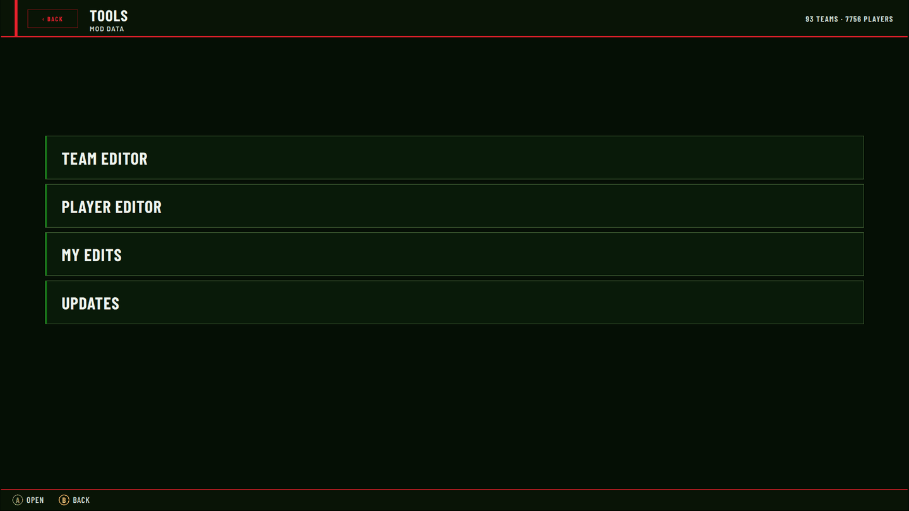

Some keys that work in both editors: `Ctrl+S` save, `Ctrl+Z` undo, `Ctrl+Y` redo, `Ctrl+F` filter, `Ctrl+N` new, `Ctrl+D` duplicate. The bar at the bottom always shows what the gamepad/keyboard can do on the selected field.

## Players

### Find or create a player
The list on the left can be filtered by name, id, position or team (`FILTERS` for more). `+ NEW PLAYER` asks for:
- In-game name (14 characters max, it is what the game shows)
- File to save into (`players.json`)
- First season and primary position

`DUPLICATE` copies the selected player, which is the fastest way to start from a similar one. Your new players get an id far above the ones of the data pack (10,000,000 and more, a different block per install), so two persons creating players never clash.

*New player:*  
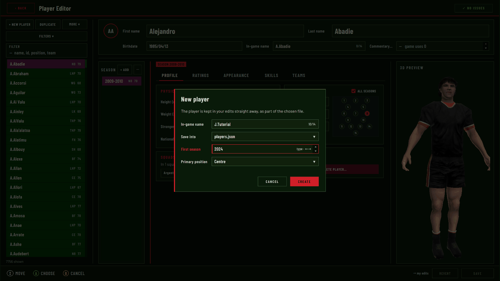

At the top you find the identity, the same for all seasons: first name, last name, birthdate (`YYYY/MM/DD`), in-game name and commentary id (leave it to 0 if you don't know).

### Seasons
A player has one set of ratings and looks **per season** (the same man is not rated the same in 2009 and 2024). The `SEASON` column lists them, `+ ADD` creates a new one (copied from another season) and `⋯` has the other actions.

Every card has an `ALL SEASONS` box. Ticked, what you change is applied to all the seasons of the player. Unticked, only to the selected one. Check it before you edit, it is the most common surprise.

### Profile
*Height, weight, stronger foot, nationality, up to 3 positions (the pitch shows which shirts the player fits), the squads where he is named (click one to jump to the team).*  
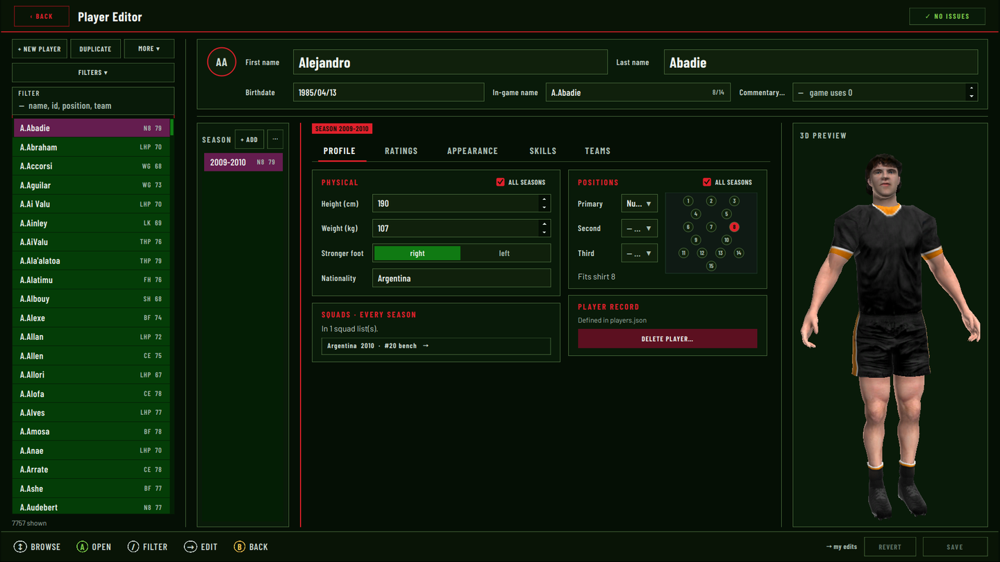

If a player doesn't fit his shirt in a team, the team editor will flag it, so choose the positions with care.

### Ratings
24 ratings in 6 groups, `OVR` is computed for the primary position. Type the number, `←→` is ±1, `⇧←→` is ±5, `Y` takes the value of the previous season. `COPY RATINGS FROM…` copies a whole season into another one.

*Ratings:*  
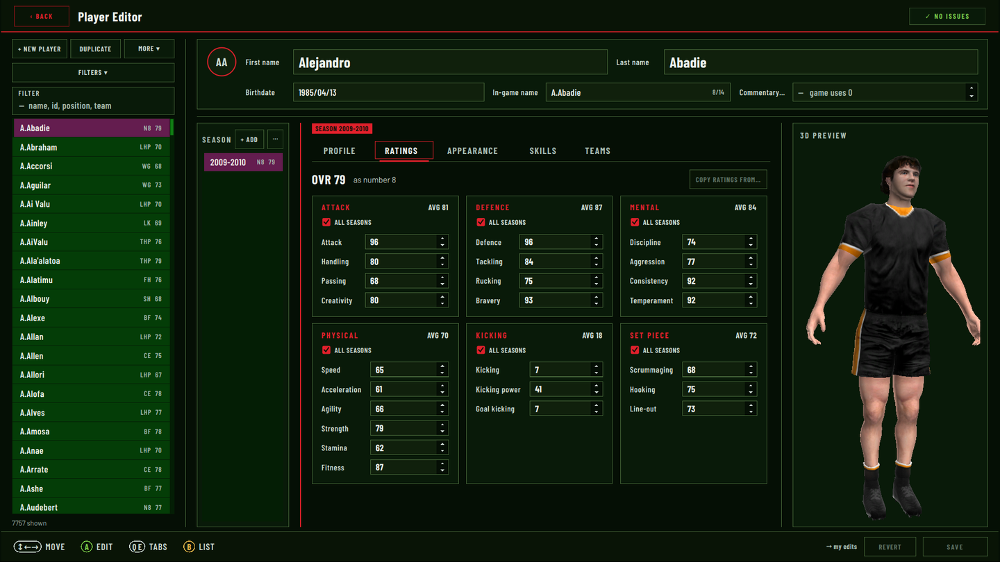

### Skills
*Extra ratings (crash ball, gap defence), AI tendency, star player ability and the 13 special skills:*  
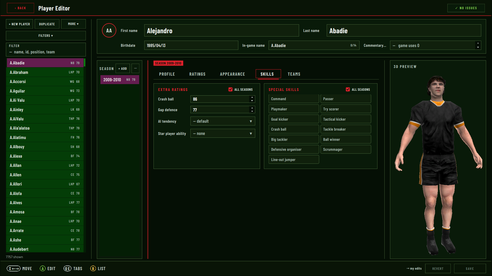

The star ability gives the player the special moves of its class (kicks, tackle breaks, ruck...) whatever his ratings are.

### Appearance
This is where the images go.

*Appearance (custom head, boots, skin and strap layers):*  
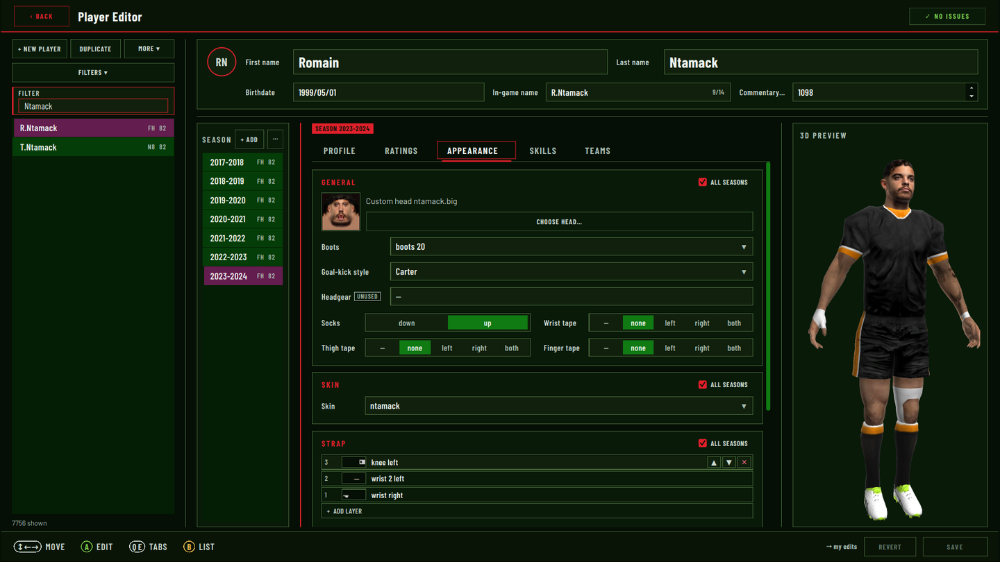

- **Head**: `CHOOSE HEAD…` opens the head browser. `stock` are the ~550 faces of the original game, `custom` are the `.big` files of `data/players/heads/`. Click one to try it on the 3D preview, then `USE THIS HEAD`.
- **Boots**: stock style 0-9, or your own image.
- **Goal-kick style**: the kicking animation of the player, any of the 20 stock ones.
- **Socks and tapes**: wrist, thigh, finger.
- **Skin**: one of the 4 stock tones, or a custom texture.
- **Layers**: strap, bottom baselayer, top baselayer, gloves. They are painted over the skin in this order, and each one can have several layers (`▲▼` to reorder, `✕` to remove).

*Head browser:*  
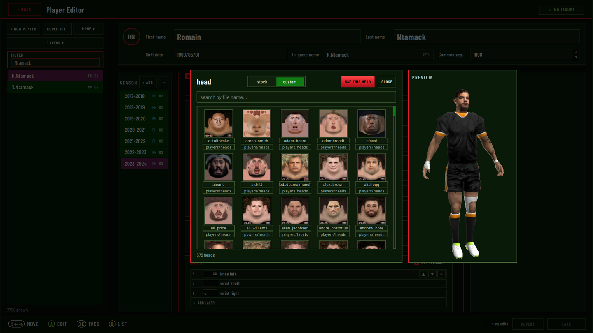

### Add your own assets
The editor only lists what is in the folders of the data pack, so **copy your file in the right folder first**, then it shows up in the lists (no restart needed):

| What | Folder | Image |
|---|---|---|
| Skin | `players/skins/` | PNG 512×256, no transparency |
| Strap layer | `players/straps/` | PNG 512×256 with transparency |
| Baselayer | `players/baselayers/` | PNG 512×256 with transparency, name it `baselayer_top_<colour>.png` or `baselayer_bottom_<colour>.png` |
| Gloves | `players/gloves/` | PNG 512×256 with transparency |
| Boots | `players/boots/` | PNG 256×256 |
| Head | `players/heads/` | `.big` file |

All the skin images share the same layout as the game skin (512×256), the easiest way is to start from an existing file of the same folder and paint over it. Layers must have transparency, otherwise they hide the whole skin: the editor tells you with a `NO ALPHA` tag. An image of another size is resized, with a `RESIZED` tag. A `MISSING` tag means the file is not found.

Then in `Appearance`, `ADD LAYER` (or the skin / boots list) shows your new files, or use `Browse file…`.

*Add a layer:*  
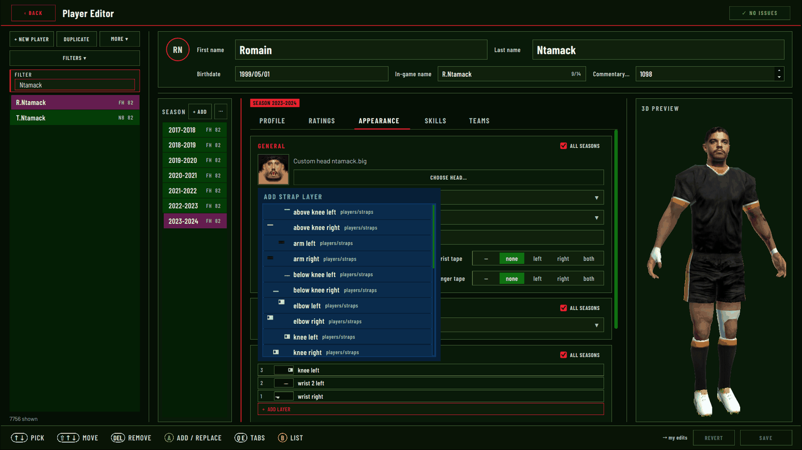

Heads are not made in the editor, they are `.big` files made with the community tools (see the heads credits in `src/CREDITS.MD`). Once the file is in `players/heads/` it is in the `custom` tab of the head browser.

### Save
`SAVE` (bottom right, `→ my edits`) keeps the player in your edits. `REVERT` goes back to the last save. The list on the left shows an issue count for broken players, the badge at the top right tells if the selected one is fine.

## Teams
`Tools > Team editor`. Same logic as the players: list on the left, then the seasons of the team, then the tabs.

### Create a team
`+ NEW TEAM` asks a name, type (club, international or special), category (Top 14, International...) and first season. It creates a folder in `teams/` with one blank season. All the images of the team live in this folder (`teams/France/kits_2024/...`), and the editor only browses inside it, so copy your files there first, like for the players.

*New team:*  
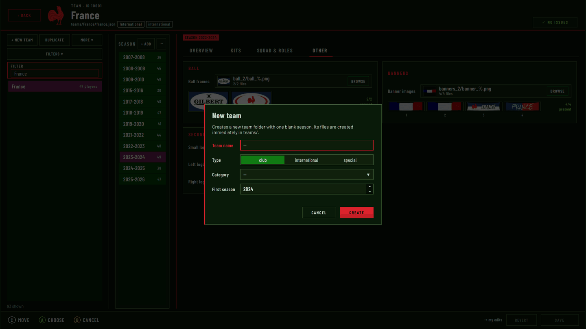

A team has one block per season (name, kits, squad, roles...). `+ ADD`, `DUPLICATE` and `DELETE` in the seasons column work on a season. Duplicating the previous season is usually the quickest way to start a new one.

### Overview
Name, type, country, category and the two logos: the main crest (256×256, shown in game) and the frontend logo (menus only, the main crest is used if blank). The summary on the right tells at a glance if something is wrong: squad size, starting XV in position, roles set, kits, missing files.

*Overview:*  
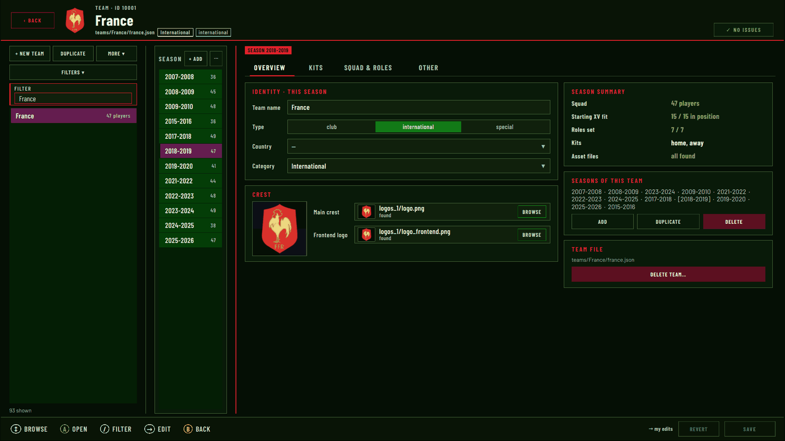

### Kits
The list on the left is the kits in game order: home, away, and as many as you want (third kit etc). You can add, duplicate, rename, delete and reorder them. Each kit has 3 files:
- **Shirt front**: 1024×1024 PNG, the shirt texture
- **Back numbers**: a series of 22 images, `home_back_1.png` to `home_back_22.png`, picked with a `%` pattern (`kits_2024/home_back/home_back_%.png`). The editor shows which numbers are present.
- **Menu picture**: the preview of the kit in the match setup

`Fit` and `Collar` only change the 3D preview of the shirt, `auto` is fine most of the time. `VARIANT` makes a copy of the kit with a few files of its own (a patch, a sponsor...).

*Kits with the 3D preview:*  
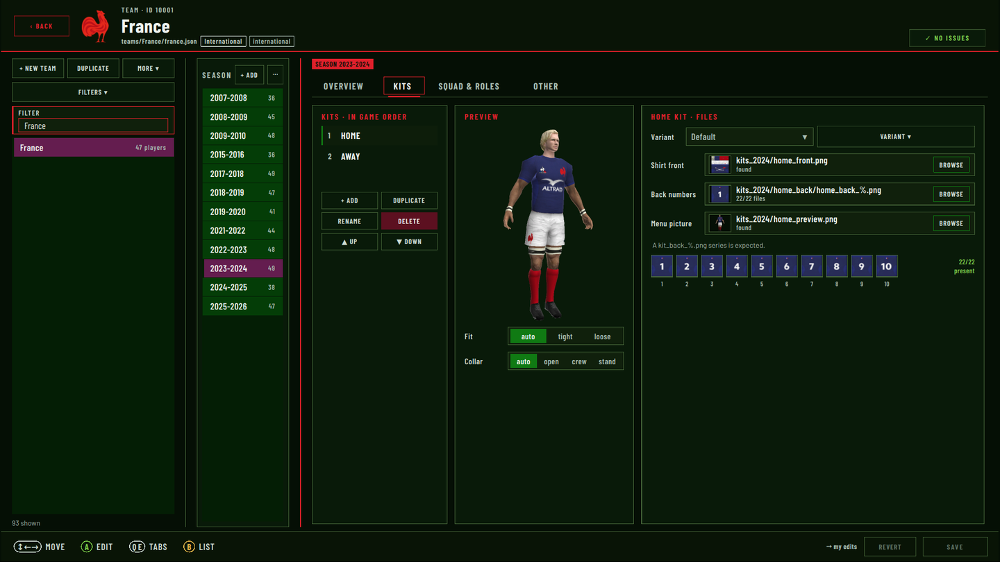

### Squad & roles
The starting XV (shirts 1-15), the 7 replacements (16-22) and the extra players, which are a pool of players beyond the 22. Click a player to pick another one (the list suggests the ones who fit the position), `X` moves him, drag and drop swaps two. This is where you put your new players in a team. On the right: captain, vice-captain, goal kicks, punts, kick-offs, and the set plays.

*Squad and roles:*  
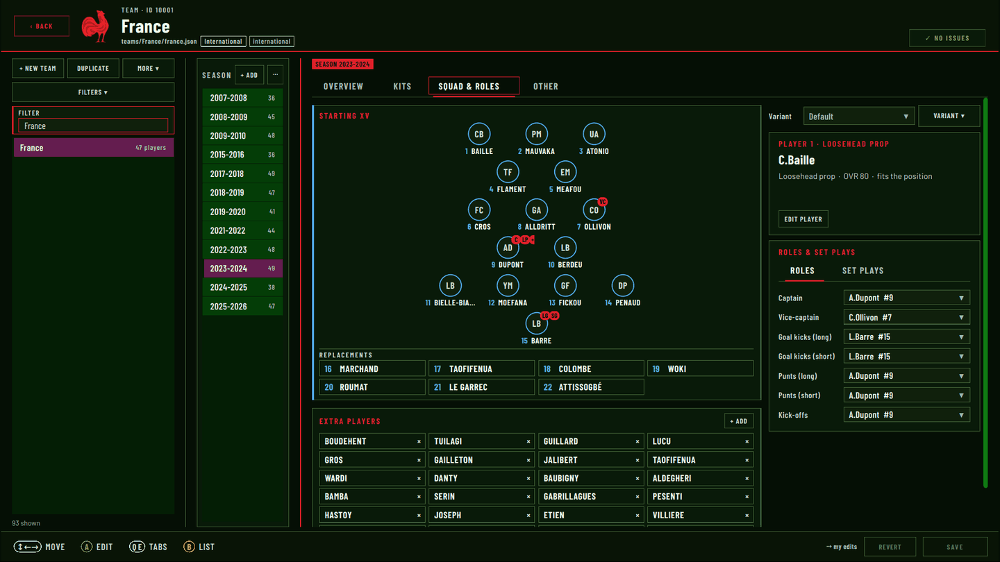

### Other
Ball (2 images, 256×128), banners (4 images, 512×128) and the 3 small logos (128×64) used on the pitch. Same thing: files in the team folder, then `BROWSE`.

*Other:*  
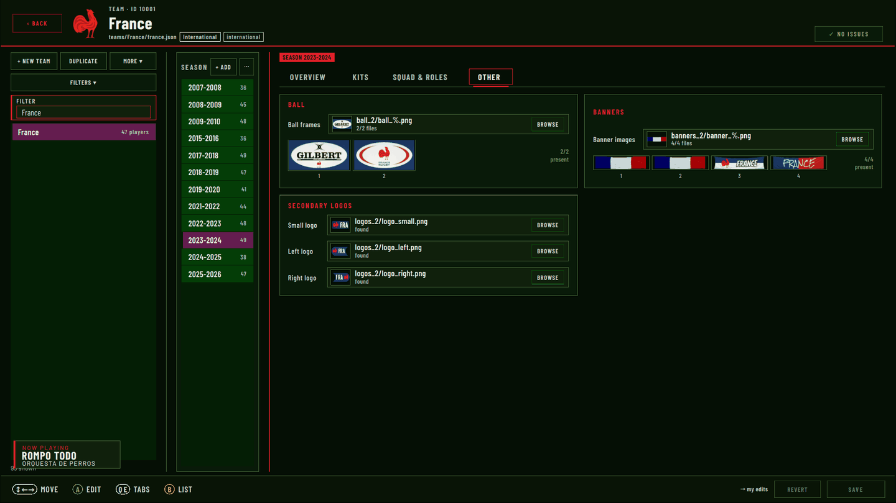

## Send your work to be added to the mod
When you are happy with your edits, open `Tools > My edits`. It lists everything you changed (`NEW` for what you created, `EDITED`, `DELETED`, and `CONFLICT` if a new release changed the same thing as you).

*My edits:*  
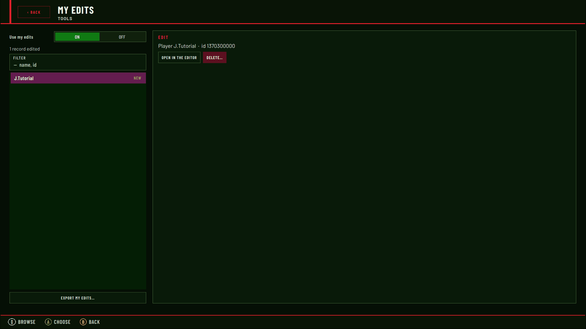

Click `EXPORT MY EDITS…`, pick a folder (`user_data/exported_edits/` is proposed) and the editor creates a folder `my_edits_<date>` with:
- `manifest.json`
- `edits/players/<id>.json` and `edits/teams/<id>.json`: one small file per record
- `files/...`: the new images you used (heads, skins, layers, kits, logos...) with the same paths as in the data pack

Zip it and send it to me (GitHub issue or the forum thread). I import it with the same tool, merge it into the data pack and it can go in a next release.

Please check before you export:
- The new assets are really in the data pack folders (otherwise they are not in `files/`)
- No `MISSING` or `NO ALPHA` tag, and `NO ISSUES` at the top right of the editors
- Only export what you want to share, `My edits` lets you drop a record you don't want (`DELETE…`)
- You own the rights of the images, or they come from a patch with a credit I can add in `CREDITS.MD`
